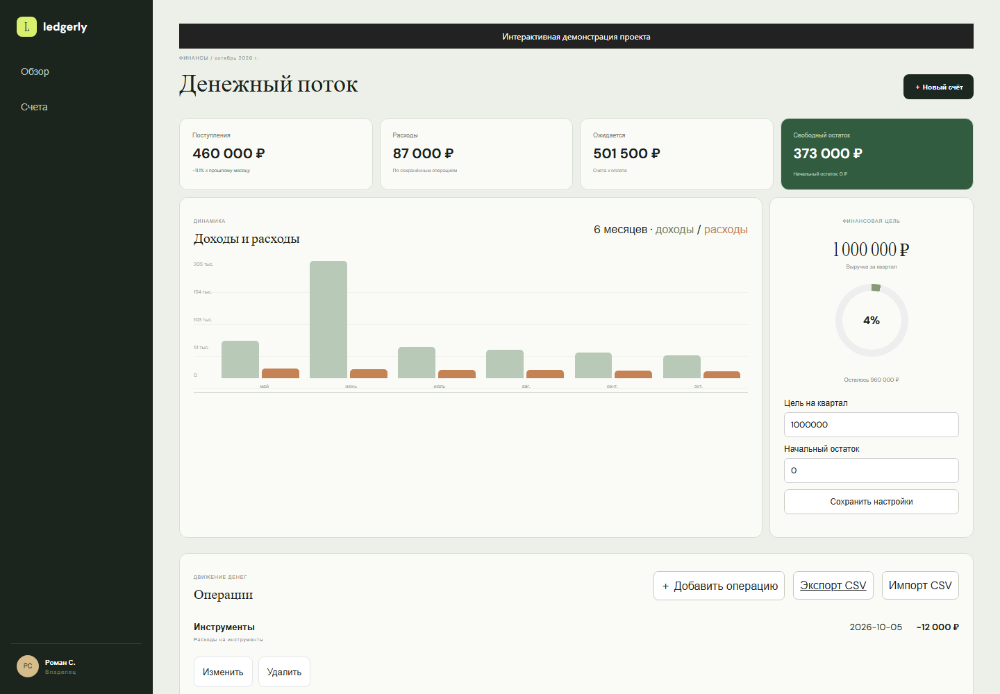
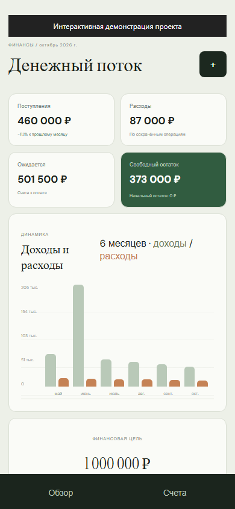
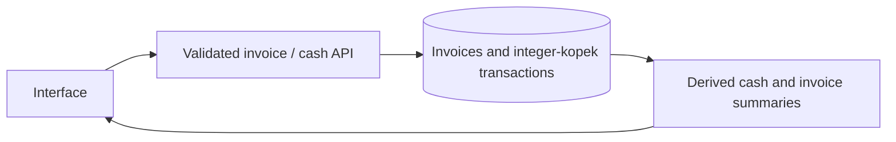

# Ledgerly — Finance Tracker

Track invoices, dated income and expenses, and calculate a cash summary from stored records.






Screenshots were captured from the running local application with its bundled fixture data.

[Earlier sandbox interaction recording](docs/demo.gif)

## Implemented

- Invoice creation, status filtering, status changes and deletion.
- Income/expense entries with validated amounts, calendar dates, categories and descriptions.
- Balance, six-month cash flow, income growth, quarterly goals and atomic CSV import/export.

## Stack and architecture

JavaScript, Express, Zod, built-in Node SQLite and a static HTML/CSS interface.



## Technical mechanisms and security

- `money.js` validates exact minor-unit inputs; `finance.js` uses BigInt for sums. `database.js` migrates invoices to canonical `amount_cents` while preserving the original REAL column. Ambiguous legacy precision aborts the entire migration rather than modifying the original values.
- Each operation is bounded to 1 billion roubles. Each income/expense total and cash range is bounded to 1 trillion roubles, including stored future entries. This conservative ceiling keeps existing numeric JSON amounts precise to a kopek. An over-limit write returns HTTP 409 and rolls back every change.
- A paid invoice contributes once to income. Moving it out of paid status or deleting it changes the derived balance. Future-dated transactions do not inflate today’s cash.
- Transaction edits and soft deletion require the version last read. An atomic conditional update prevents silent overwrite; HTTP 409 preserves the browser’s draft. Deletion removes an entry from reports and export but retains its database record.
- CSV parsing bounds size/rows/columns and escapes spreadsheet formula prefixes on export. Import hash lookup and writes share `BEGIN IMMEDIATE`: concurrent identical requests return the same result. Replaying the same CSV is an operation replay, so it never undoes later edits/deletions. A different file reusing an existing UUID with different content returns 409, including deleted UUIDs.
- Database triggers validate new/changed amounts, dates and operation types. Startup and schema changes are transactional. Sample rows are seeded only for a new database.
- The API is for a local operator. The Host allowlist and same-origin write policy reject DNS-rebinding hosts and cross-origin browser writes. `APP_PUBLIC_ORIGIN` can specify one reverse-proxy origin; a public proxy must separately enforce authentication and TLS.

## Local setup

Node.js 24.18.0 and pnpm 11.7.0 (see version files).

```bash
npm install --global pnpm@11.7.0
pnpm install --frozen-lockfile
pnpm start
```

Open `http://localhost:4300`. For live UI development use `pnpm dev` where available. The API binds to `127.0.0.1` by default.

## Configuration

Configure process environment variables using [.env.example](.env.example). `pnpm start` uses the process environment; it does not implicitly load that file. To load a copied `.env` explicitly, run `node --env-file=.env server.js`.

## Database and upgrades

SQLite is stored at `data/ledgerly.db`. Initialization creates/migrates the schema; sample rows are included for local use. Back up the database before upgrades. Do not remove the database as a migration step.

## Verification

```bash
pnpm lint
pnpm format:check
pnpm test
pnpm test:contract
pnpm test:upgrade
pnpm exec playwright install chromium
pnpm test:e2e
pnpm audit --audit-level=high
```

`tests/audit.test.js` covers precision and restart without reseeding. `tests/financial-invariants.test.js` checks generated order/partition invariants, edit/delete/CAS and atomic range failures. `tests/money-migration.test.js` verifies legacy rollback/preservation. `tests/import-concurrency.test.js` starts two HTTP servers with separate connections to one temporary database and verifies duplicate-import serialization. Browser tests exercise editing, a stale-version draft and deletion on desktop and mobile.

CI installs locked dependencies, runs lint/format, unit/API, contract, upgrade and browser tests, and scans known dependency advisories. A passing scanner is time-specific, not a security guarantee.

## Limits and next steps

- One local operator; no accounts, bank connections, transfers, payment processing or multi-currency accounting. Categories are user labels, not a chart of accounts. The goal is an income target, not a category budget engine.
- The transaction list shows the newest 100 entries; CSV export supports up to 1,000 active entries. Large ledgers need pagination/streaming. Calculations scan stored entries and favour correctness over large-dataset throughput.
- Existing databases must be backed up before startup migration. Invalid legacy amounts or a pre-existing out-of-range ledger require operator review/offline repair; the application does not silently clamp or delete records.
- The legacy invoice REAL column remains for compatibility, but reports and CSV use canonical integer minor units. Direct SQL writers must supply both consistent columns. Existing HTTP response fields remain available.
- Cookie sessions are not used here. Host/origin validation does not authenticate a person and cannot secure an unauthenticated public deployment by itself.

## Further documentation

[Audit findings and follow-up](docs/AUDIT_2026_10.md) · [Technical reference](docs/TECHNICAL.md) · [Change history](CHANGELOG.md)

[API request/response example](docs/API_EXAMPLE.md)

[Revision and deployment checks](docs/DEPLOYMENT_CHECKS.md) — read-only `pnpm smoke` verifies a running Node API and an optional expected source SHA.
