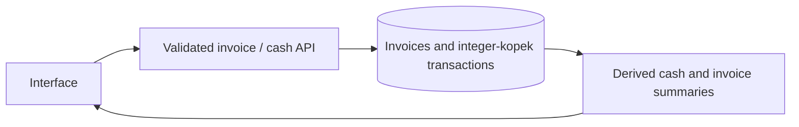

# Ledgerly — Finance Tracker

Track invoices, dated income and expenses, and calculate a cash summary from stored records.


[Short interaction recording](docs/demo.gif)

## Implemented

- Invoice creation, status filtering, status changes and deletion.
- Income/expense entries with validated amounts, calendar dates, categories and descriptions.
- Balance, six-month cash flow, income growth, quarterly goals and atomic CSV import/export.

## Stack and architecture

JavaScript, Express, Zod, built-in Node SQLite and a static HTML/CSS interface.



## Technical mechanisms and security

- `finance.js` converts validated amounts into integer kopecks. Cash totals and the invoice summary are computed from stored records rather than fixed UI values. Legacy invoice REAL amounts are rounded to kopecks on read.
- A paid invoice contributes once to income. Moving it out of paid status or deleting it changes the derived balance without creating a second payment transaction. Future-dated transactions do not inflate today’s cash.
- CSV parsing bounds size/rows/columns. Import is transactional; stable operation UUIDs and import hashes reject conflicting retries and prevent duplicate additions. Export escapes spreadsheet formula prefixes.
- Initialization seeds only a newly created database, not every empty invoice table. Deliberately removing all invoices and restarting does not create new invoices or duplicate cash entries.

## Local setup

Node.js 24.18.0 and pnpm 11.7.0 (see version files).

```bash
npm install --global pnpm@11.7.0
pnpm install --frozen-lockfile
pnpm start
```

Open `http://localhost:4300`. For live UI development use `pnpm dev` where available. The API binds to `127.0.0.1` by default.

## Configuration

Configure process environment variables using [.env.example](.env.example). `pnpm start` uses the process environment; it does not implicitly load that file. To load a copied `.env` explicitly, run `node --env-file=.env server.js`.

## Database and upgrades

SQLite is stored at `data/ledgerly.db`. Initialization creates/migrates the schema; sample rows are included for local use. Back up the database before upgrades. Do not remove the database as a migration step.

## Verification

```bash
pnpm test
pnpm test:contract
pnpm test:upgrade
pnpm exec playwright install chromium
pnpm test:e2e
pnpm audit --audit-level=high
```

`tests/audit.test.js` reproduces 0.29-rouble summary precision, repeated paid transitions, reversal/deletion, an empty summary and restart without reseeding. Existing finance tests cover invalid dates/amounts, CSV atomicity, duplicate imports and formula escaping.

CI installs locked dependencies and runs the configured checks; documentation checks also validate local links/images. Python dependency auditing uses `pip-audit --disable-pip --no-deps --strict -r requirements-lock.txt`. A passing scanner only reports known advisories at the time of the run.

## Limits and next steps

- Single-user local application without authentication, bank connections, payment processing, tax or accounting certification. Do not expose personal financial data on an open network.
- Transaction endpoints support listing, creation and CSV import/export. General transaction editing/deletion and multi-currency ledgers are not implemented.
- JavaScript integer sums have a finite safe-integer ceiling. Inputs are bounded to 1 billion roubles per operation; arbitrary-scale accounting would need checked aggregates or decimal storage throughout.
- The legacy invoice table still uses REAL; a future migration to integer minor units should preserve existing records and define rounding explicitly.

## Further documentation

[Audit findings and follow-up](docs/AUDIT_2026_10.md) · [Technical reference](docs/TECHNICAL.md) · [Change history](CHANGELOG.md)

[API request/response example](docs/API_EXAMPLE.md)
